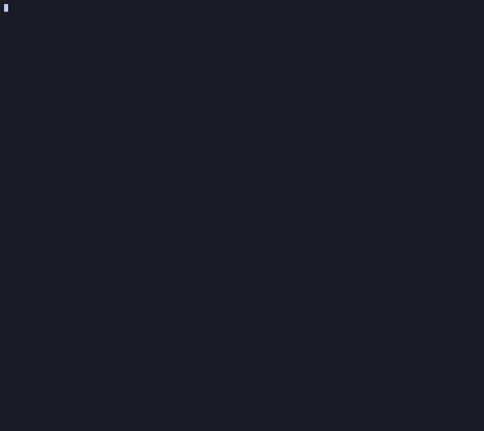

<h1 align="center">

</h1>


[](https://www.npmjs.com/package/vigievuln)
[](https://www.npmjs.com/package/vigievuln)
[](LICENSE)
[](https://nodejs.org)
[](https://github.com/9pings/VigieVuln/actions/workflows/ci.yml)


**VigieVuln 1.3.5** is a polyglot dependency auditor for code audits.

It scans dependencies and **11 CMS/frameworks** in one pass without build tools, supports **air-gapped** workflows, detects private packages, binaries and certificates, and produces HTML, JSON and other reports.


🌐 **[Project site & docs →](https://9pings.github.io/VigieVuln/)**

*Terminal demo recorded with VigieVuln 1.2.1.*

<p align="center"></p>

## Features

- **Multiple ecosystems in one pass**: Maven and Gradle, npm/Yarn/pnpm, Composer, PyPI, NuGet, Go and Ruby — plus **vendored JS**, committed **native binaries** and **embedded JARs**.
- **No build tools**; No `mvn`/`gradle`/`npm`/`pip`/`dotnet`/`go`, no `node_modules/` → [how](docs/COMPARISON.md#how-its-autonomous-no-build-tools)
- **CVE from multiple sources, merged & prioritised**; CVEProject + OSV.dev + Packagist security advisories + NVD, ranked **CISA KEV → EPSS → CVSS**.
- **European vulnerability references**: ENISA **EUVD** id + ENISA's exploited flag, **GCVE** id, and the **CERT-FR** advisories citing it. Hosted proxy lookups send relevant CVE identifiers to the proxy.
- **Beyond CVEs**; Report **EOL and out-of-active-support** frameworks, deprecated/abandoned/yanked, outdated, SPDX **licenses**, and **private/internal packages**
- **CMS & frameworks audited as instances**; Symfony, Laravel, WordPress, Drupal, Joomla, PrestaShop, TYPO3, Magento/Adobe Commerce and SPIP with per-instance inventory (core, plugins, themes, bundles, components) → [the dedicated guide](docs/CMS-FRAMEWORKS.md)
- **Crypto material**; committed **certificates**, **private vs public keys** across PEM/OpenSSH/PuTTY/PGP and JKS/PKCS#12 keystores.
- **Air-gapped flow**; **zero network under `--offline`** → [Benchmark](docs/BENCHMARK.md) · [Air-gapped](#air-gapped-audits)
- **Native image audits**; Docker/OCI archives, registries and rootfs inventories without Docker; Linux packages, ELF/Go metadata and publisher SBOMs, with explicit coverage. Image analysis in source scans is off by default; use `--images` or the separate `vigievuln system scan` command → [image guide](docs/IMAGES.md)
- **Hosted proxy with a verified account**; `--set-proxy-cache vigievuln` → [hosted proxy](docs/USAGE.md#hosted-vigievuln-proxy)
- **Project monitoring**; `vigievuln watch ./project --name 'My Project'` — one free project with up to **100 distinct direct dependency coordinates** → [monitoring guide](docs/USAGE.md#project-monitoring)
- **Shared cache for a scanner fleet**; `vigievuln serve-cache` + `--proxy-cache`  → [cache usage](docs/USAGE.md#shared-proxy-cache-server-serve-cache----proxy-cache)
- **Supply-chain risk**; known-**malicious** advisories and suspected **typosquats** (`--typosquat`).
- **Audit-grade**; every report carries a **provenance manifest** and a **Methodology & limitations** chapter; a `SHA256SUMS`;
- **Differential audits** diff against a prior run (`--baseline`) and CI can gate on *new* findings only.
- **Reports in English or French** (`--lang fr`)
- **Outputs & CI**; Pro HTML report + JSON baseline by default + Word, Excel, CycloneDX 1.6 SBOM, CSAF 2.0 VEX, SARIF 2.1.0, JSON; gate with `--fail-on`, triage with `--ignore`/`--vex`.
- Report **made for productivity**; every table / chart has a **Copy for word** button.

📖 **[Usage & all flags](docs/USAGE.md)** · **[Architecture](docs/ARCHITECTURE.md)** · **[Comparison vs other tools](docs/COMPARISON.md)** · **[Data sources](docs/DATA-SOURCES.md)**

> [!IMPORTANT]
> **Although VigieVuln is an excellent tool—comprehensive, rigorously tested, and regularly updated—it is still relatively new, and like any other scanner, it may occasionally produce errors.
> Whenever possible, cross-check important findings with another analysis tool — though, among the tools we compared, none offers reports as comprehensive as VigieVuln.**

## Quick start

```bash
npm install -g vigievuln
vigievuln scan ./code             # → ./vigievuln-report/cve-report.html
```

### Faster scans using personal NVD API key

A free [NVD API key](https://nvd.nist.gov/developers/request-an-api-key) (instant) gives 10× faster enrichment: `vigievuln --set-nvd-key YOUR_KEY`. A few common runs; full list via `vigievuln --help` or [docs/USAGE.md](docs/USAGE.md)

### Faster scans using the VigieVuln DB European hosted cache

Use [Vigie Vuln DB](https://www.vigievuln.fr/) as a European-hosted source for scans, including reviewed VigieVuln advisories for Maven and npm.

```bash
vigievuln login                 # sign in and select the official proxy if none is configured
vigievuln scan ./code           # scan using the saved proxy and key
vigievuln setup --mode direct --sources all  # switch back to direct sources
```

The proxy receives package coordinates and CVE identifiers, not source code. Cached advisories remain usable offline; partial version evidence leaves other versions unknown. [Proxy guide](docs/USAGE.md#hosted-vigievuln-proxy).

### Include container images

Add `--images` to scan supported container images referenced by the project alongside its dependencies, without Docker; this option is off by default.

```bash
vigievuln scan ./code --images
```

The report keeps source and image findings in separate summaries and charts, highlighting vulnerable images and their most critical CVEs. [Image inputs, options and coverage](docs/IMAGES.md).

## Why use vigievuln ?

An author-maintained comparison of audit workflows; see [`docs/COMPARISON.md`](docs/COMPARISON.md)
for versions, sources and limitations. `⚠️` indicates partial or conditional support.

| What an auditor actually needs to do                                                       | **VigieVuln** | OSV | Trivy | Grype+Syft | OWASP DC | Snyk |
| ------------------------------------------------------------------------------------------ | :-: | :-: | :-: | :-: | :-: | :-: |
| Audit a **100-module polyglot monorepo in one command**, with **no toolchain installed**  | ✅ 105 modules | ⚠️ reactor skipped | ⚠️ needs `~/.m2` | ⚠️ opt-in | ⚠️ Java build | ⚠️ `mvn` build |
| **Scan offline / air-gapped with cached data**                                            | ⚠️ cached metadata | ⚠️ limited | ⚠️ `~/.m2` | ⚠️ opt-in | ⚠️ mirror | ❌ |
| **Identify the private/internal deps** across a big project                               | ✅ | ❌ | ❌ | ❌ | ❌ | ❌ |
| **Extract cleaned deps descriptors** into an external directory                           | ✅ `-t` | ❌ | ❌ | ❌ | ❌ | ❌ |
| **Report EOL / deprecated frameworks & deps**, transitive ones included                   | ✅ | ⚠️ deprecated only | ⚠️ OS distros only | ❌ | ❌ | ⚠️ web UI only |
| **Report committed keys & certificates**                                                  | ✅ | ❌ | ⚠️ key rule | ❌ | ❌ | ❌ |
| **Spot committed binaries** (`.dll`, `.exe`, …) and check them against their checksums    | ✅ | ❌ | ⚠️ some | ⚠️ patterns | ❌ | ❌ |
| **Clearly list what was *not* scanned** — before the client asks                          | ✅ warnings + method | ⚠️ log | ⚠️ log | ⚠️ log | ⚠️ log | ⚠️ log |
| **Answer "against what data?" six months later**                                          | ✅ | ❌ | ❌ | ⚠️ DB date | ⚠️ NVD date | ❌ |
| **Send a report, not a JSON dump**                                                       | ✅ HTML + `.doc` | ⚠️ HTML list | ⚠️ template | ❌ | ⚠️ HTML list | ⚠️ `snyk-to-html` |
| **Charts, per-CVE drill-down and a pasteable Word copy**                                 | ✅ | ❌ | ❌ | ❌ | ❌ | ❌ |
| **Make delta reports showing only what changed**                                         | ✅ `--baseline` | ❌ | ❌ | ❌ | ❌ | ⚠️ cloud |
| **Audit CMS/framework instances as such** — plugins, themes, publisher advisories       | ✅ 9 products | ❌ | ❌ | ❌ | ❌ | ❌ |
| **Share one cache across the fleet**, API keys server-side                               | ✅ `serve-cache` | ❌ | ⚠️ local DB | ⚠️ local DB | ⚠️ local DB | ⚠️ cloud |


**Deliberately not a goal: reachability.** ( That's an AI or human Job )

## More examples

```bash
vigievuln scan ./proj -e "^com\.acme\."                        # exclude private libs (coord regex)
vigievuln scan ./proj -t ../clean -e "^com\.acme\."            # extract only: normalised descriptors, private modules flagged
vigievuln scan ./proj -t ../clean -e "^com\.acme\." -a snyk   # same extraction + scan + merge Snyk
vigievuln scan ./proj --offline                                # fully offline (zero network, needs a warmed cache)
vigievuln scan ./proj -a osv-db,typosquat                      # OSV advisory matching + typosquat
vigievuln scan ./proj -a licenses --fail-on high               # license chapter + CI gate
vigievuln scan ./proj --report-json --baseline last.json --fail-on-new   # differential audit: fail CI on NEW findings
vigievuln diff last.json this.json                           # standalone diff of two findings JSONs
vigievuln scan ./proj -r html,json,xlsx                        # include the Excel workbook
vigievuln scan ./site --app-plugins wordpress --private-component wp-content/plugins/acme --offline
```

> [!IMPORTANT]
> **`--offline` reads the cache, it doesn't replace it.** On a *cold* cache there is nothing to
> match against;
> Air-gapped machines get their cache via [`--export-cache` / `--import-cache`](#air-gapped-audits).


## CMS & frameworks

See the [CMS coverage limits](docs/CMS-FRAMEWORKS.md#coverage-and-its-current-limits)
and [shared-cache operating limits](docs/USAGE.md#shared-proxy-cache-server-serve-cache----proxy-cache).

VigieVuln inventories the **instance**: core, plugins, themes, bundles and framework components with their observed versions, attributes dependency findings where ownership is established, and reports each instance in its own sub-chapter.

| Product | Inventory | Advisory lane |
| --- | --- | --- |
| **WordPress** | core (`wp-includes/version.php`), plugins (public or private by `Update URI`), themes | **Wordfence** production feed (API key, or a warmed catalogue offline) + **core checksums** integrity (api.wordpress.org) |
| **Drupal** | core (lock + `Drupal.php` marker), modules incl. `modules/contrib`, themes, profiles, Drupal 7 branch | **packages.drupal.org** per-package security advisories |
| **Symfony** | framework, framework-components, bundles, libraries; **Symfony Flex recipes** (`symfony.lock`) | the dependency lanes (OSV.dev, Packagist, NVD) — no publisher feed exists, and the coverage says so |
| **Laravel** | framework, bundles, libraries | the dependency lanes (OSV.dev, Packagist, NVD) |
| **PrestaShop** | core (`_PS_VERSION_`), modules, themes | the publisher's **GitHub security-advisories** feed |
| **TYPO3** | core, extensions | the publisher's **GitHub security-advisories** feed |
| **SPIP** | core (`$spip_version_branche` in `ecrire/inc_version.php`), dist plugins (`paquet.xml`), user plugins (`paquet.xml`/legacy `plugin.xml`) | **NVD product CVEs** (`cpe:2.3:a:spip:spip`) — the only machine-readable SPIP source; plugins stay honestly not-qualified |
| **Joomla / Magento (Adobe Commerce)** | core, extensions/modules, themes | no machine-readable publisher feed exists; components locked as Composer packages read as covered by the **dependency lanes**, the rest stays honestly **not qualified**. A Magento source distribution reports its exact version from the root `composer.json` |

Private/custom components are inventoried separately and never sent to any publisher. → **[the dedicated guide](docs/CMS-FRAMEWORKS.md)** · [application usage](docs/USAGE.md#application-inventory-experimental)

## Air-gapped audits

Scan a confidential or disconnected project by preparing its advisory and dependency cache on an online machine. The source code and detailed report stay offline.

```bash
# Offline: export coordinates, excluding internal packages; review before transfer
vigievuln scan ./proj -e "^(client|internal)\." --export-anonymized deps.json

# Online: prepare a project-specific cache from the reviewed descriptor
vigievuln cache prepare deps.json --output vigievuln-cache.tar.gz

# Offline: import the cache and generate the report locally
vigievuln --import-cache vigievuln-cache.tar.gz
vigievuln scan ./proj --offline
```

Review the descriptor before sharing and the report's coverage and freshness information after scanning. An incomplete or outdated cache can limit results. [Offline workflow and cache options](docs/USAGE.md).

## Docs

- [`docs/USAGE.md`](docs/USAGE.md); every flag and workflow: offline/cache control, private registries, config files, recipes, safety rails.
- [`docs/CMS-FRAMEWORKS.md`](docs/CMS-FRAMEWORKS.md); the CMS/framework instance view: detection markers, per-product advisory lanes, coverage semantics and the air-gapped workflow.
- [`docs/ARCHITECTURE.md`](docs/ARCHITECTURE.md); internals: codecs, collection, matching, report pipeline.
- [`docs/COMPARISON.md`](docs/COMPARISON.md); vs OSV-Scanner / Trivy / Grype / OWASP DC / Snyk, and how it stays build-free.
- [`docs/BENCHMARK.md`](docs/BENCHMARK.md) — dated scanner comparisons on pinned projects, including warm and cold offline limitations.
- [`docs/DATA-SOURCES.md`](docs/DATA-SOURCES.md); the public datasets vigievuln uses + their licenses.
- [`CHANGELOG.md`](CHANGELOG.md) · [`CLAUDE.md`](CLAUDE.md); current release notes · code-level orientation for contributors.

### Interactive HTML samples

- **[Apache Dubbo 2.7.8 — open the report](https://9pings.github.io/VigieVuln/samples/dubbo.html)**: the project used for the report screenshot below, rescanned with VigieVuln 1.2.1; 105 Maven descriptors, direct/transitive CVEs, KEV matches, EOL and fix recommendations.
- **[Multi-instance CMS & frameworks — open the report](https://9pings.github.io/VigieVuln/samples/multi-cms-frameworks.html)**: WordPress 6.4.2, Drupal 8.5.0, Symfony Demo (Symfony 7.1.1) and BookStack v24.10 (Laravel 10.48.22), with findings attributed to each instance.

These are standalone reports from real source scans, generated on **2026-11-04** with VigieVuln **1.2.1**. Dubbo uses the hosted proxy; the CMS sample uses its local cache offline and focuses on PHP dependencies. Missing Wordfence/Drupal advisory and WordPress checksum inputs are explicitly marked incomplete. [Sample scope, sources and reproduction commands](docs/samples/README.md).

### Resolution and coverage

- **Gradle:** without a lock, POM-based resolution can differ from Gradle. Locks cover only their recorded configurations, which may mix runtime, tests and build tools.
- **Python:** exact pins are checked; transitives require a supported resolved lockfile or complete inventory.
- **Coverage:** missing metadata or unavailable advisory sources can cause omissions or false positives. Review report warnings.

See [usage](docs/USAGE.md) and [measured results](docs/BENCHMARK.md).

## Contributing

The most useful contribution to a young scanner is **telling it where it's wrong**: run it on a
real project and file a [false positive / false negative report](https://github.com/9pings/VigieVuln/issues/new?template=false_positive.yml)
with the coordinate and the manifest snippet that produced it. Dev setup, ground rules and the
codec extension point → [`CONTRIBUTING.md`](CONTRIBUTING.md). Vulnerabilities in vigievuln
itself → [`SECURITY.md`](SECURITY.md) (please report privately).

## License

Apache-2.0; see [`LICENSE`](LICENSE).
