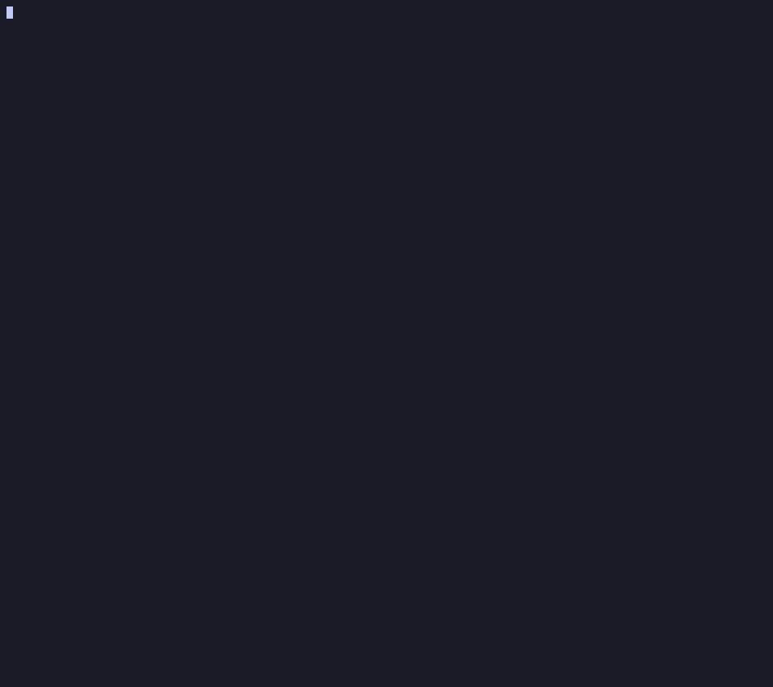
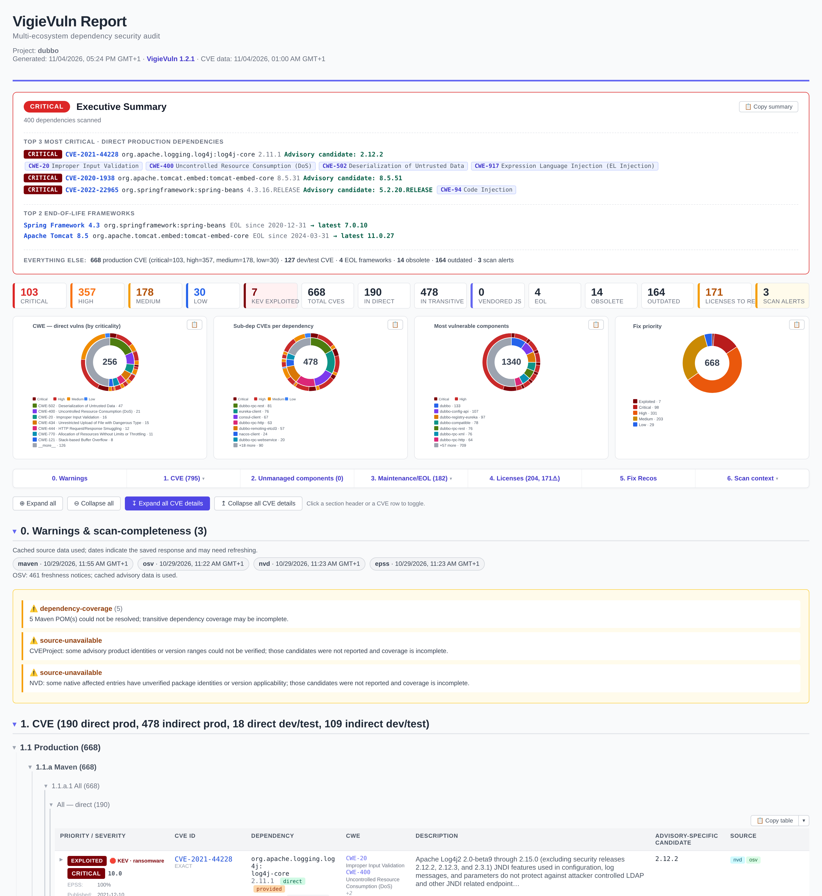

<h1 align="center">

</h1>


[](https://www.npmjs.com/package/vigievuln)
[](https://www.npmjs.com/package/vigievuln)
[](LICENSE)
[](https://nodejs.org)
[](https://github.com/9pings/VigieVuln/actions/workflows/ci.yml)


**VigieVuln** is a polyglot dependency auditor built for **professional code audits**.

It scans dependencies and **9 CMS/frameworks** in one pass without build tools, supports **air-gapped** workflows, detects private packages, binaries and certificates, and produces HTML, JSON and other reports.


🌐 **[Project site & docs →](https://9pings.github.io/VigieVuln/)**

*Terminal demo recorded with VigieVuln 1.0.1.*

<p align="center"></p>

## Features

- **Multiple ecosystems in one pass**: Maven and Gradle, npm/Yarn/pnpm, Composer, PyPI, NuGet, Go and Ruby — plus **vendored JS**, committed **native binaries** and **embedded JARs**.
- **No build tools**; No `mvn`/`gradle`/`npm`/`pip`/`dotnet`/`go`, no `node_modules/` → [how](docs/COMPARISON.md#how-its-autonomous-no-build-tools)
- **CVE from multiple sources, merged & prioritised**; CVEProject + OSV.dev + Packagist security advisories + NVD, ranked **CISA KEV → EPSS → CVSS**.
- **European vulnerability references**: ENISA **EUVD** id + ENISA's exploited flag, **GCVE** id, and the **CERT-FR** advisories citing it. Hosted proxy lookups send relevant CVE identifiers to the proxy.
- **Beyond CVEs**; Report **EOL and out-of-active-support** frameworks, deprecated/abandoned/yanked, outdated, SPDX **licenses**, and **private/internal packages**
- **CMS & frameworks audited as instances**; Symfony, Laravel, WordPress, Drupal, Joomla, PrestaShop, TYPO3, Magento/Adobe Commerce and SPIP with per-instance inventory (core, plugins, themes, bundles, components) → [the dedicated guide](docs/CMS-FRAMEWORKS.md)
- **Crypto material**; committed **certificates**, **private vs public keys** across PEM/OpenSSH/PuTTY/PGP and JKS/PKCS#12 keystores.
- **Air-gapped flow**; **zero network under `--offline`** → [Benchmark](docs/BENCHMARK.md) · [Air-gapped](#air-gapped-audits)
- **Hosted proxy with a verified account**; `--set-proxy-cache vigievuln` → [hosted proxy](docs/USAGE.md#hosted-vigievuln-proxy)
- **Project monitoring**; `vigievuln watch ./project --name 'My Project'` — one free project with up to **100 distinct direct dependency coordinates** → [monitoring guide](docs/USAGE.md#project-monitoring)
- **Shared cache for a scanner fleet**; `vigievuln serve-cache` + `--proxy-cache`  → [cache usage](docs/USAGE.md#shared-proxy-cache-server-serve-cache----proxy-cache)
- **Supply-chain risk**; known-**malicious** advisories and suspected **typosquats** (`--typosquat`).
- **Audit-grade**; every report carries a **provenance manifest** and a **Methodology & limitations** chapter; a `SHA256SUMS`;
- **Differential audits** diff against a prior run (`--baseline`) and CI can gate on *new* findings only.
- **Reports in English or French** (`--lang fr`)
- **Outputs & CI**; Pro HTML report + JSON baseline by default + Word, Excel, CycloneDX 1.6 SBOM, CSAF 2.0 VEX, SARIF 2.1.0, JSON; gate with `--fail-on`, triage with `--ignore`/`--vex`.
- Report **made for productivity**; every table / chart has a **Copy for word** button.

📖 **[Usage & all flags](docs/USAGE.md)** · **[Architecture](docs/ARCHITECTURE.md)** · **[Comparison vs other tools](docs/COMPARISON.md)** · **[Data sources](docs/DATA-SOURCES.md)**

## Quick start

```bash
npm install -g vigievuln
vigievuln scan ./code             # → ./vigievuln-report/cve-report.html
```

A free [NVD API key](https://nvd.nist.gov/developers/request-an-api-key) (instant) gives 10× faster enrichment: `vigievuln --set-nvd-key YOUR_KEY`. A few common runs; full list via `vigievuln --help` or [docs/USAGE.md](docs/USAGE.md)

### Monitor a project

Monitor your project's direct dependencies for new high, critical or known exploited vulnerabilities. Create and verify a [Vigie Vuln account](https://www.vigievuln.fr/account) first.

```bash
vigievuln login                                  # sign in and accept the terms
vigievuln watch ./project --export deps.json     # optional: review the inventory locally
vigievuln watch ./project --name 'My Project'     # upload or update the project
vigievuln project status                         # check the monitoring status
```

Review the inventory before sharing, enable alerts in your account and upload again when dependencies change. The free tier covers one project, 100 direct coordinates and a 0.5 MB descriptor; each upload renews monitoring for one month. [Monitoring guide](docs/USAGE.md#project-monitoring).

### Official Vigie Vuln proxy cache

Use [Vigie Vuln DB](https://www.vigievuln.fr/) as a European-hosted source for scans, including reviewed VigieVuln advisories for Maven and npm.

```bash
vigievuln login                 # sign in and select the official proxy if none is configured
vigievuln scan ./code           # scan using the saved proxy and key
vigievuln setup --mode direct --sources all  # switch back to direct sources
```

The proxy receives package coordinates and CVE identifiers, not source code. Cached advisories remain usable offline; partial version evidence leaves other versions unknown. [Proxy guide](docs/USAGE.md#hosted-vigievuln-proxy).

### Interactive HTML samples

- **[Apache Dubbo 2.7.8 — open the report](https://9pings.github.io/VigieVuln/samples/dubbo.html)**: the project used for the report screenshot below, rescanned with VigieVuln 1.1.3; 105 Maven descriptors, direct/transitive CVEs, KEV matches, EOL and fix recommendations.
- **[Multi-instance CMS & frameworks — open the report](https://9pings.github.io/VigieVuln/samples/multi-cms-frameworks.html)**: WordPress 6.4.2, Drupal 8.5.0, Symfony Demo (Symfony 7.1.1) and BookStack v24.10 (Laravel 10.48.22), with findings attributed to each instance.

These are standalone reports from real source scans, generated on **2026-10-29** using the hosted proxy and local caches. The CMS sample focuses on PHP dependencies; WordPress advisory coverage is explicitly incomplete without a Wordfence feed. [Sample scope, sources and reproduction commands](docs/samples/README.md).

> [!WARNING]
> vigievuln is new and may still contain ( rare ) bugs. Treat its output as a strong first pass, **double-check anything critical**, and please [report issues](https://github.com/9pings/VigieVuln/issues); they get fixed fast.

## Why use vigievuln for code audits?

An author-maintained comparison of audit workflows; see [`docs/COMPARISON.md`](docs/COMPARISON.md)
for versions, sources and limitations. `⚠️` indicates partial or conditional support.

| What an auditor actually needs to do                                                       | **VigieVuln** | OSV | Trivy | Grype+Syft | OWASP DC | Snyk |
| ------------------------------------------------------------------------------------------ | :-: | :-: | :-: | :-: | :-: | :-: |
| Audit a **100-module polyglot monorepo in one command**, with **no toolchain installed**  | ✅ 105 modules | ⚠️ reactor skipped | ⚠️ needs `~/.m2` | ⚠️ opt-in | ⚠️ Java build | ⚠️ `mvn` build |
| **Scan offline / air-gapped with cached data**                                            | ⚠️ cached metadata | ⚠️ limited | ⚠️ `~/.m2` | ⚠️ opt-in | ⚠️ mirror | ❌ |
| **Identify the private/internal deps** across a big project                               | ✅ | ❌ | ❌ | ❌ | ❌ | ❌ |
| **Extract cleaned deps descriptors** into an external directory                           | ✅ `-t` | ❌ | ❌ | ❌ | ❌ | ❌ |
| **Report EOL / deprecated frameworks & deps**, transitive ones included                   | ✅ | ⚠️ deprecated only | ⚠️ OS distros only | ❌ | ❌ | ⚠️ web UI only |
| **Report committed keys & certificates**                                                  | ✅ | ❌ | ⚠️ key rule | ❌ | ❌ | ❌ |
| **Spot committed binaries** (`.dll`, `.exe`, …) and check them against their checksums    | ✅ | ❌ | ⚠️ some | ⚠️ patterns | ❌ | ❌ |
| **Clearly list what was *not* scanned** — before the client asks                          | ✅ warnings + method | ⚠️ log | ⚠️ log | ⚠️ log | ⚠️ log | ⚠️ log |
| **Answer "against what data?" six months later**                                          | ✅ | ❌ | ❌ | ⚠️ DB date | ⚠️ NVD date | ❌ |
| **Send a report, not a JSON dump**                                                       | ✅ HTML + `.doc` | ⚠️ HTML list | ⚠️ template | ❌ | ⚠️ HTML list | ⚠️ `snyk-to-html` |
| **Charts, per-CVE drill-down and a pasteable Word copy**                                 | ✅ | ❌ | ❌ | ❌ | ❌ | ❌ |
| **Make delta reports showing only what changed**                                         | ✅ `--baseline` | ❌ | ❌ | ❌ | ❌ | ⚠️ cloud |
| **Audit CMS/framework instances as such** — plugins, themes, publisher advisories       | ✅ 9 products | ❌ | ❌ | ❌ | ❌ | ❌ |
| **Share one cache across the fleet**, API keys server-side                               | ✅ `serve-cache` | ❌ | ⚠️ local DB | ⚠️ local DB | ⚠️ local DB | ⚠️ cloud |


Offline dependency resolution depends on cached metadata. In the Dubbo test, a cold advisory seed alone produced 185 groups versus 734 with warm metadata and reported missing POMs; see the [benchmark](docs/BENCHMARK.md) for scope and warnings.

**Deliberately not a goal: reachability.** A finding is a vulnerable version on the dependency
graph, and the report says exactly that (in Methodology) instead of guessing at call paths. Deciding
whether the vulnerable code is reachable in *this* application is the auditor's call, made with
application context no scanner has.

## More examples

```bash
vigievuln -s ./proj -e "^com\.acme\."                        # exclude private libs (coord regex)
vigievuln -s ./proj -t ../clean -e "^com\.acme\."            # extract only: normalised descriptors, private modules flagged
vigievuln -s ./proj -t ../clean -e "^com\.acme\." -a snyk   # same extraction + scan + merge Snyk
vigievuln -s ./proj --offline                                # fully offline (zero network, needs a warmed cache)
vigievuln -s ./proj -a osv-db,typosquat                      # OSV advisory matching + typosquat
vigievuln -s ./proj -a licenses --fail-on high               # license chapter + CI gate
vigievuln -s ./proj --report-json --baseline last.json --fail-on-new   # differential audit: fail CI on NEW findings
vigievuln diff last.json this.json                           # standalone diff of two findings JSONs
vigievuln -s ./proj -r html,json,xlsx                        # include the Excel workbook
vigievuln -s ./site --app-plugins wordpress --private-component wp-content/plugins/acme --offline
```

> [!IMPORTANT]
> **`--offline` reads the cache, it doesn't replace it.** On a *cold* cache there is nothing to
> match against; an empty report is not evidence that the project is clean. Initialise it from
> a seed or warm it online, then review coverage and freshness warnings in the offline report.
> Cached advisories can match other applicable versions, but neither a partial cache nor an
> old snapshot guarantees complete or current results.
> Air-gapped machines get their cache via [`--export-cache` / `--import-cache`](#air-gapped-audits).

## What it finds

The report keeps the six root chapters. Sub-chapters appear only when they contain results and are numbered consecutively; application inventory and methodology remain available in scan context:

| Chapter | Source | What it catches |
| --- | --- | --- |
| **0. Warnings** *(top)* | local heuristics | Missing lockfiles, unresolved Maven versions (BOM-managed), private packages absent from configured registries |
| **Δ. Changes since baseline** *(top, with `--baseline`)* | diff vs prior JSON | New / fixed / unchanged findings per category + the list of **new production CVEs**; for repeat audits and `--fail-on-new` CI gating |
| **1. CVE** *(X direct, Y indirect, Z dev)* | CVEProject + OSV.dev + Packagist + qualified publisher feeds + NVD/CPE | **Applications first when findings exist**; CMS/framework findings by instance and owner · **Production**; public CVE / GHSA in other prod deps, per ecosystem, per manifest, **prioritised** by CISA KEV + EPSS + CVSS · **Vendored JS vulns** ([retire.js](https://retirejs.github.io/)) — one row per physical library, linked CVEs + CWEs on the row, every advisory behind a click · **Dev** (`test`/`provided`, `dev`/`optional`/`peer`) · **Likely false positives** (CPE-filtered) |
| **2. Unmanaged / unversioned components** | deps.dev + CIRCL (by checksum), retire.js, built-in X.509 | **Embedded binaries**; CVEs in libs shipped inside committed `.jar`/`.war`/`.ear` (fat-jars, shaded uber-jars) · **Native binaries** (`.dll`/`.exe`/`.so`/`.dylib`): available metadata and checksum evidence; metadata alone does not reliably identify a product or establish CVE applicability · **Vendored JavaScript** inventory (jQuery, Bootstrap, …) vulnerable *or not* · **Certificates &amp; key material**; committed certs (expiry / weak key / weak signature / self-signed), **private vs public keys** (PEM/OpenSSH/PuTTY/PGP/SSH) and keystores, all parsed offline |
| **3. Maintenance / EOL** *(X EOL, Y obsolete, Z outdated)* | endoflife.date · curated + registry flags · Maven Central / npm / Packagist / PyPI / NuGet | **End-of-Life** frameworks (+ an "Out of active support" band with `--eol-support`; Symfony/Laravel grouped as one row per framework; PHP runtime when the Composer constraint proves it), split **direct** (declared / parent-POM-inherited — bump these) vs **transitive** (bump the dep that pulls them in) · **Obsolete / deprecated / abandoned / yanked** · **Outdated** (newer version available, with release dates; direct deps only) |
| **4. Licenses** *(opt-in: `--licenses`)* | registry metadata + Maven POMs → SPDX policy | Each dep's license normalised to SPDX and classified; copyleft (GPL/AGPL/LGPL/MPL), proprietary and unknown flagged for review |
| **5. Fix Recommendations** | computed | Per-ecosystem pin recipes: Maven `<dependencyManagement>`, Gradle `constraints { }`, npm `overrides`, yarn `resolutions`, `composer require`, `pip install`, `dotnet add package` |
| **6. Scan context & limitations** | provenance manifest + walk | **Scanned descriptors** (every manifest parsed) · **Ignored directories** (pruned paths + rule) · **Methodology, data sources & limitations** (data-source freshness, run config, explicit statement of **what vigievuln does *not* assess**) · **Application inventory & coverage** (also shown when no CVE matches) |
| **Supply-chain risk** *(cross-cutting)* | OSV `MAL-…` + name heuristic | **Known-malicious** packages (always block the CI gate, any `--fail-on` level) and **suspected typosquats** (`--typosquat`: an npm/PyPI name one edit from a popular package; `lodahs`↔`lodash`) |

The HTML report opens in any browser, contains every detail (CVSS vectors, references, full descriptions, CPE configurations, via-paths for transitives) and ships a Word-compatible `.doc` twin. Every match carries a **composite priority** (KEV-exploited > EPSS likelihood > CVSS severity), and the run can additionally emit a **CycloneDX 1.6 SBOM** (`--report-sbom`, vulnerabilities inline) and a **CSAF 2.0 VEX** (`--report-csaf`) for downstream tooling.

<p align="center"></p>


## CMS & frameworks

See the [CMS coverage limits](docs/CMS-FRAMEWORKS.md#coverage-and-its-current-limits)
and [shared-cache operating limits](docs/USAGE.md#shared-proxy-cache-server-serve-cache--proxy-cache).

vigievuln doesn't just read the `composer.json` under a WordPress or Drupal site — it inventories the **instance**: core, plugins, themes, bundles and framework components with their observed versions, attributes every dependency CVE to the component that ships it, and reports each instance in its own sub-chapter — synthesis included even when it comes out clean. Any recognized layout is activated by the default `--app-plugins auto`; `none` opts out.

| Product | Inventory | Advisory lane |
| --- | --- | --- |
| **WordPress** | core (`wp-includes/version.php`), plugins (public or private by `Update URI`), themes | **Wordfence** production feed (API key, or a warmed catalogue offline) + **core checksums** integrity (api.wordpress.org) |
| **Drupal** | core (lock + `Drupal.php` marker), modules incl. `modules/contrib`, themes, profiles, Drupal 7 branch | **packages.drupal.org** per-package security advisories |
| **Symfony** | framework, framework-components, bundles, libraries; **Symfony Flex recipes** (`symfony.lock`) | the dependency lanes (OSV.dev, Packagist, NVD) — no publisher feed exists, and the coverage says so |
| **Laravel** | framework, bundles, libraries | the dependency lanes (OSV.dev, Packagist, NVD) |
| **PrestaShop** | core (`_PS_VERSION_`), modules, themes | the publisher's **GitHub security-advisories** feed |
| **TYPO3** | core, extensions | the publisher's **GitHub security-advisories** feed |
| **SPIP** | core (`$spip_version_branche` in `ecrire/inc_version.php`), dist plugins (`paquet.xml`), user plugins (`paquet.xml`/legacy `plugin.xml`) | **NVD product CVEs** (`cpe:2.3:a:spip:spip`) — the only machine-readable SPIP source; plugins stay honestly not-qualified |
| **Joomla / Magento (Adobe Commerce)** | core, extensions/modules, themes | no machine-readable publisher feed exists; components locked as Composer packages read as covered by the **dependency lanes**, the rest stays honestly **not qualified**. A Magento source distribution reports its exact version from the root `composer.json` |

Every advisory snapshot a live lane fetches is stamped and cached in the local SQLite database, **prepared from the air-gapped descriptor** by `cache prepare`, and reused automatically offline — the Wordfence API key never travels to the enclave. Private/custom components are inventoried separately and never sent to any publisher. → **[the dedicated guide](docs/CMS-FRAMEWORKS.md)** · [application usage](docs/USAGE.md#application-inventory-experimental)

## Air-gapped audits

Scan a confidential or disconnected project by preparing its advisory and dependency cache on an online machine. The source code and detailed report stay offline.

```bash
# Offline: export coordinates, excluding internal packages; review before transfer
vigievuln -s ./proj -e "^(client|internal)\." --export-anonymized deps.json

# Online: prepare a project-specific cache from the reviewed descriptor
vigievuln cache prepare deps.json --output vigievuln-cache.tar.gz

# Offline: import the cache and generate the report locally
vigievuln --import-cache vigievuln-cache.tar.gz
vigievuln -s ./proj --offline
```

Review the descriptor before sharing and the report's coverage and freshness information after scanning. An incomplete or outdated cache can limit results. [Offline workflow and cache options](docs/USAGE.md).

## Docs

- [`docs/USAGE.md`](docs/USAGE.md); every flag and workflow: offline/cache control, private registries, config files, recipes, safety rails.
- [`docs/CMS-FRAMEWORKS.md`](docs/CMS-FRAMEWORKS.md); the CMS/framework instance view: detection markers, per-product advisory lanes, coverage semantics and the air-gapped workflow.
- [`docs/ARCHITECTURE.md`](docs/ARCHITECTURE.md); internals: codecs, collection, matching, report pipeline.
- [`docs/COMPARISON.md`](docs/COMPARISON.md); vs OSV-Scanner / Trivy / Grype / OWASP DC / Snyk, and how it stays build-free.
- [`docs/BENCHMARK.md`](docs/BENCHMARK.md) — dated scanner comparisons on pinned projects, including warm and cold offline limitations.
- [`docs/DATA-SOURCES.md`](docs/DATA-SOURCES.md); the public datasets vigievuln uses + their licenses.
- [`CHANGELOG.md`](CHANGELOG.md) · [`CLAUDE.md`](CLAUDE.md); release history · code-level orientation for contributors.

## Contributing

The most useful contribution to a young scanner is **telling it where it's wrong**: run it on a
real project and file a [false positive / false negative report](https://github.com/9pings/VigieVuln/issues/new?template=false_positive.yml)
with the coordinate and the manifest snippet that produced it. Dev setup, ground rules and the
codec extension point → [`CONTRIBUTING.md`](CONTRIBUTING.md). Vulnerabilities in vigievuln
itself → [`SECURITY.md`](SECURITY.md) (please report privately).

**On AI assistance:** this codebase is written with heavy use of Claude Code; [`CLAUDE.md`](CLAUDE.md)
in the repo root is exactly what it looks like. The bar it's held to is the one you can check
yourself: the test suite (`npm test`), the zero-network guarantee enforced by a tripwire test and
and the dated comparisons and limitations documented in [`docs/BENCHMARK.md`](docs/BENCHMARK.md). `vigievuln` itself uses **no LLM at runtime**; findings come from public
vulnerability databases and deterministic parsers, and no report text is generated. Full
statement, including where review actually caught a bad finding →
[`AI_POLICY.md`](AI_POLICY.md). Where the code doesn't meet that bar, that's a bug report I want.

## License

Apache-2.0; see [`LICENSE`](LICENSE).
